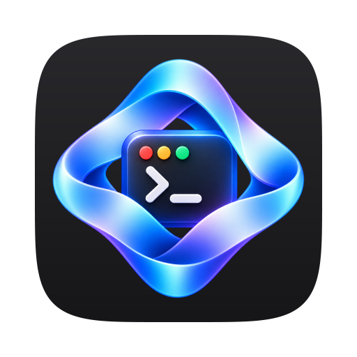

<p align="center">
  
</p>

<h1 align="center">omp-webui</h1>

<p align="center"><a href="https://omp.sh">omp</a> 编程代理的网页界面和 macOS 应用。</p>

<p align="center"><a href="README.md">English</a> · <b>简体中文</b></p>

<p align="center">
  <picture>
    <source media="(prefers-color-scheme: dark)" srcset="docs/screenshots/chat-zh-CN-dark.png">
    
  </picture>
</p>

## 主要功能

- **所有对话都能搜索**：所有 omp 对话按日期和项目分组，⌘K 全文搜索，用 ‹ 1/2 › 在分支之间切换。
- **看得见的子代理**：实时的子代理树，显示状态、费用和记录，可以引导或停止任何一个；代理关系图画出谁启动了谁、谁给谁发了消息。
- **token、费用和额度**：每一轮都有和终端一致的统计行，合计包含子代理，有用量仪表盘，也显示每个提供商还剩多少额度。
- **按你的方式用模型**：一键切换 omp 的模型角色和预设，目标模式和计划模式，还有只加载你选定的工具、MCP 服务器和技能的轻量模式。
- **看守危险命令**：主代理和每个子代理的高风险工具调用，都要等审核模型或你批准后才运行。
- **无人值守模式**：你不在时代理继续工作，把要问你的问题记到“问题”列表里。
- **在手机上用**：经 Cloudflare Tunnel 和 Access 远程访问，适合窄屏的布局，对话需要你时推送通知。
- **macOS 应用**：替你安装 omp，从发布页自动更新，可以在菜单栏后台运行，还能把你的设置迁移到另一台 Mac。

## 安装

**macOS 应用**（Apple 芯片，macOS 13 或更高）：从[最新发布](../../releases/latest)下载 `omp-webui-vX.Y.Z.dmg`，把 **omp-webui** 拖到 **Applications（应用程序）**，然后在终端运行一次：

```sh
xattr -dr com.apple.quarantine /Applications/omp-webui.app
```

应用用自签名证书签名、没有经过 Apple 公证，这条命令去掉隔离标记（也可以在“系统设置 › 隐私与安全性”里点“仍要打开”）。第一次打开时，如果还没有 [omp](https://omp.sh)，应用会提供安装。

**从源码运行**，供开发使用（任何装有 [Bun](https://bun.sh) ≥ 1.3、且 `omp` 在 `PATH` 里的系统）：

```sh
bun install
bun run build
bun run start          # 然后打开它打印的 http://127.0.0.1:7878/?token=… 链接
```

配置（端口、监听地址、数据文件夹、远程访问）和故障排除见[技术文档](docs/TECHNICAL.zh-CN.md#配置与开发)。

## 链接

- [技术文档](docs/TECHNICAL.zh-CN.md)（[English](docs/TECHNICAL.md)）：每个功能的细节、使用、故障排除、配置、安全、远程访问、测试和发布。
- [发布说明](release-notes/)：每个版本一个文件，中英双语。
- [Issues](../../issues)：报告问题或提出需求。写明 omp-webui 的版本（侧栏里的版本行）、`omp --version` 和发生了什么；问题是公开的，不要写进令牌、带 `?token=…` 的链接以及不愿公开的主机名或路径。详见[问题与拉取请求](docs/TECHNICAL.zh-CN.md#问题与拉取请求)。

这个仓库从 v0.12.2 开始；之前的问题编号（代码、测试和发布说明里的）指的是之前那个仓库。
